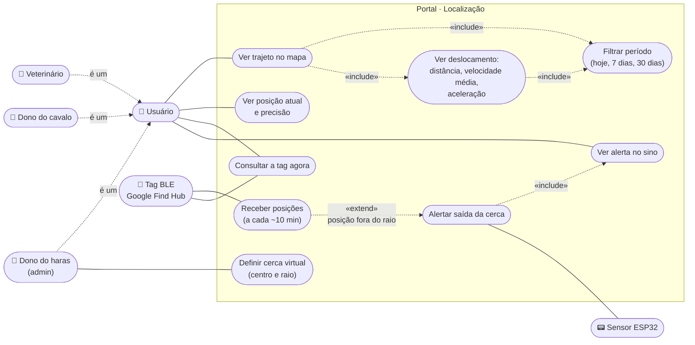
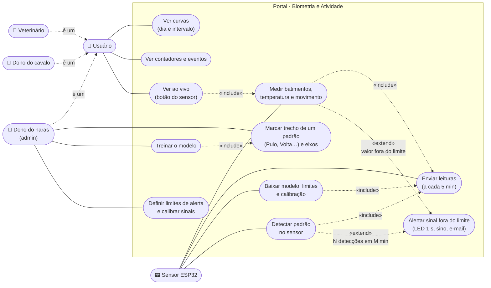
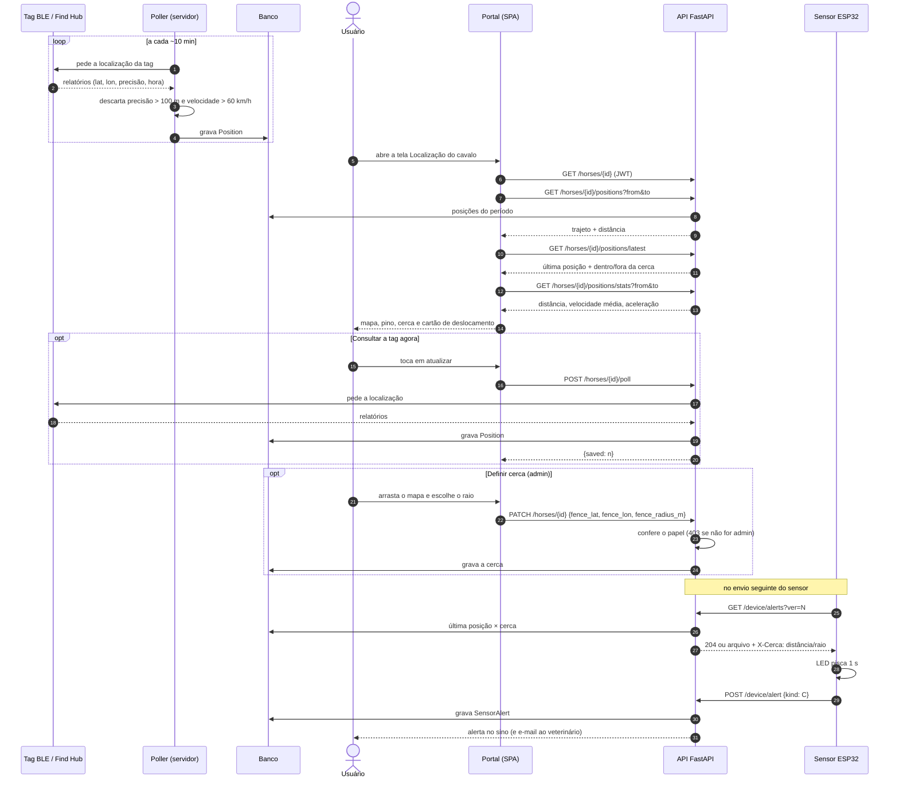
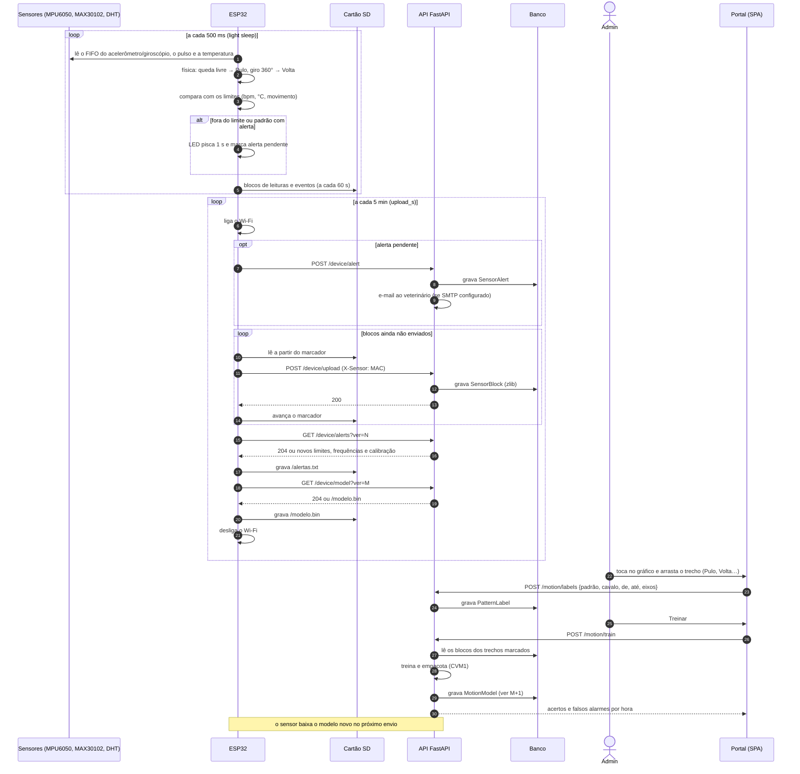
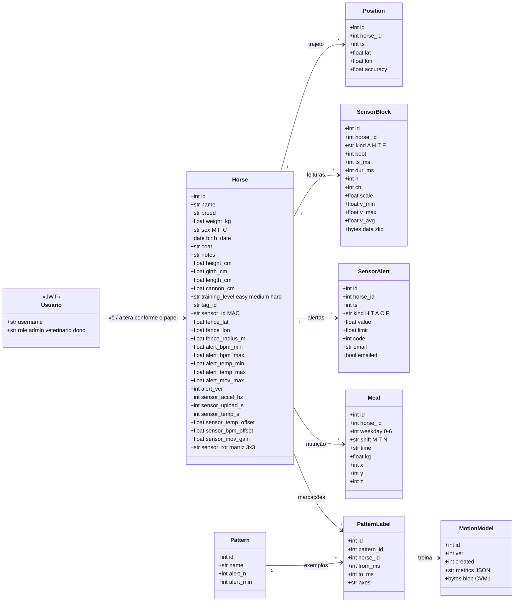
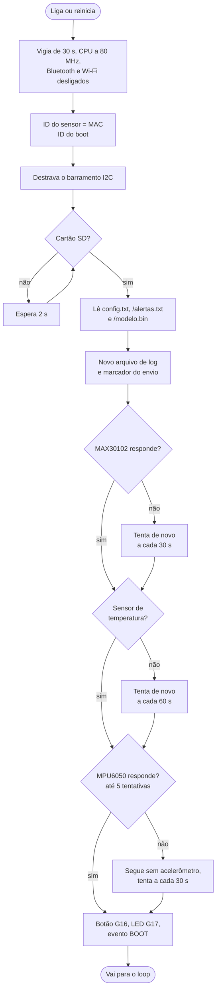
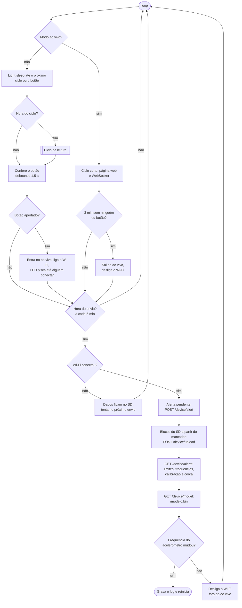
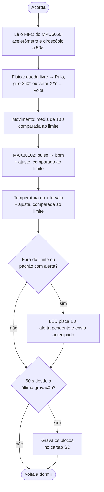

# Diagramas do sistema

Atores:

| Ator | Login | O que pode fazer |
|---|---|---|
| Dono do haras (admin) | `admin` | Tudo |
| Veterinário | `veterinario` | Ver tudo; mudar nutrição e características do cavalo |
| Dono do cavalo | `dono` | Ver tudo; mudar a intensidade do treino (easy, medium, hard) |
| Tag BLE (Google Find Hub) | — | Ator externo: informa a posição do cavalo |
| Sensor ESP32 | — | Ator externo: mede e envia biometria e movimento |

Os casos de uso que todos os logins fazem estão ligados ao ator **Usuário**, a generalização dos três acessos.

---

## UC1 · Tela de Localização

| Caso de uso | Ator | Descrição |
|---|---|---|
| Ver trajeto no mapa | Usuário | O mapa mostra os pontos do período, ligados em ordem de tempo |
| Filtrar período | Usuário | Seleção de hoje, 7 dias ou 30 dias; vale para o trajeto e o deslocamento |
| Ver posição atual e precisão | Usuário | Pino com o último ponto, a precisão (± m) e há quanto tempo foi visto |
| Ver deslocamento | Usuário | Cartão flutuante com distância, velocidade média e aceleração do período |
| Consultar a tag agora | Usuário, Tag | Pede a posição à rede Find Hub sem esperar o ciclo de 10 min |
| Definir cerca virtual | Admin | Arrastar o mapa para o centro e escolher o raio (30 a 1000 m) |
| Receber posições | Tag | O servidor consulta a tag a cada ~10 min e descarta pontos imprecisos ou impossíveis |
| Alertar saída da cerca | Sistema | Com a posição fora do raio, o alerta vai para o sino e o sensor ESP32 avisa com o LED |
| Ver alerta no sino | Usuário | Lista de alertas; tocar abre a tela do cavalo |

---

## UC2 · Coleta de padrões biométricos

| Caso de uso | Ator | Descrição |
|---|---|---|
| Medir batimentos, temperatura e movimento | ESP32 | MAX30102 a 25 leit./s, temperatura no intervalo configurado, acelerômetro e giroscópio a 50 leit./s |
| Enviar leituras | ESP32 | Envia a cada 5 min; se falhar, guarda no cartão SD e manda no próximo envio |
| Ver curvas | Usuário | Biometria: bpm e °C. Atividade: intensidade e X, Y, Z, com dia e intervalo de tempo |
| Marcar trecho de um padrão | Admin | No gráfico de 30 s, arrastar o trecho, escolher os eixos e o padrão |
| Treinar o modelo | Admin | O servidor gera o modelo e mostra acertos e falsos alarmes por hora |
| Baixar modelo, limites e calibração | ESP32 | Junto do envio: só baixa se a versão mudou |
| Detectar padrão no sensor | ESP32 | Física: pulo por queda livre (≥ 5 cm), volta pelo giro ou pela rotação do vetor X/Y |
| Ver contadores e eventos | Usuário | Contadores por padrão no dia e lista de eventos com horário |
| Definir limites de alerta e calibrar | Admin | Mínimo, máximo e frequência por sensor; prévia da curva calibrada com os limites em vermelho |
| Alertar sinal fora do limite | Sistema | LED pisca 1 s; o alerta fica no sino do portal e o veterinário recebe e-mail |
| Ver ao vivo | Usuário | Apertar o botão do sensor abre a página ao vivo na rede Wi-Fi; desliga após 3 min sem ninguém |

---

## Diagramas de sequência

### SD1 · Localização: posição da tag, tela e alerta de cerca

### SD2 · Coleta biométrica, padrões e alerta

---

## Diagrama de classes (banco de dados)

`Usuario` não é tabela: os três logins são fixos na configuração do servidor e o papel vai dentro do JWT.

---

## Fluxograma do firmware (ESP32)

O firmware tem três partes: a inicialização (`setup`), o laço principal (`loop`, com o envio) e o ciclo de leitura, que roda a cada 500 ms.

### 1 · Inicialização

### 2 · Laço principal e envio

### 3 · Ciclo de leitura (a cada 500 ms)

